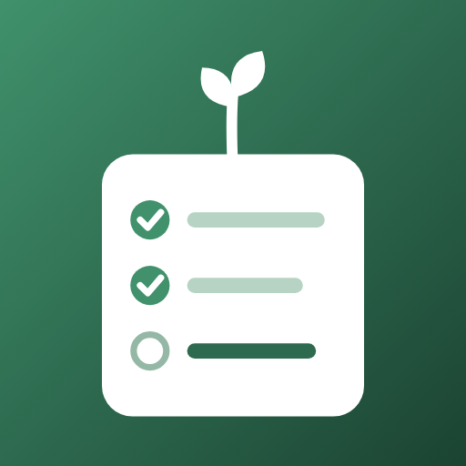
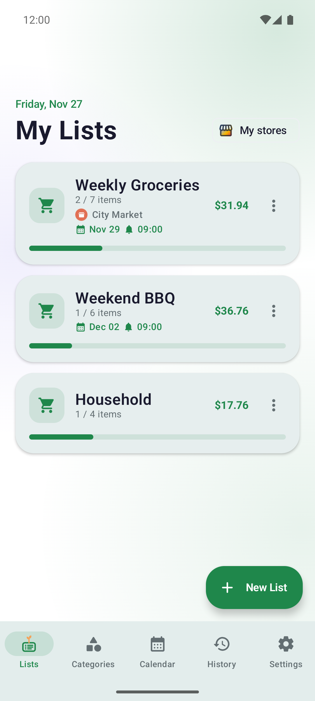
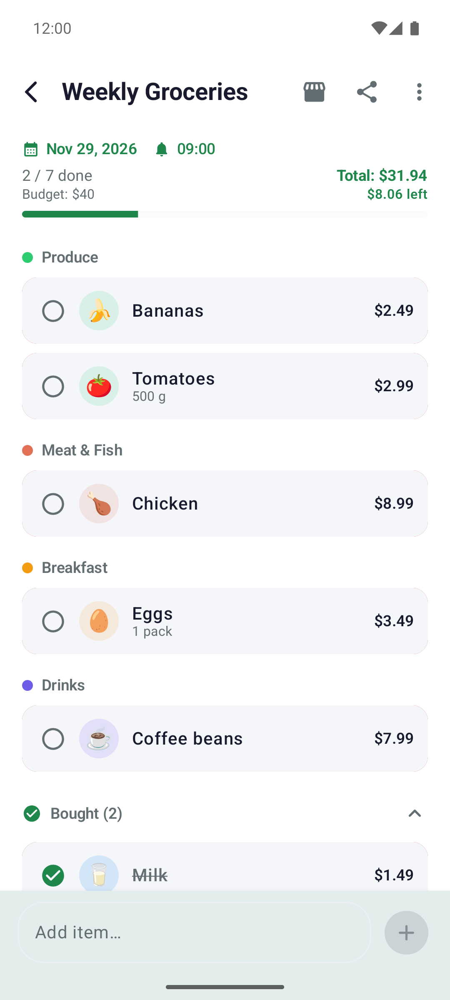
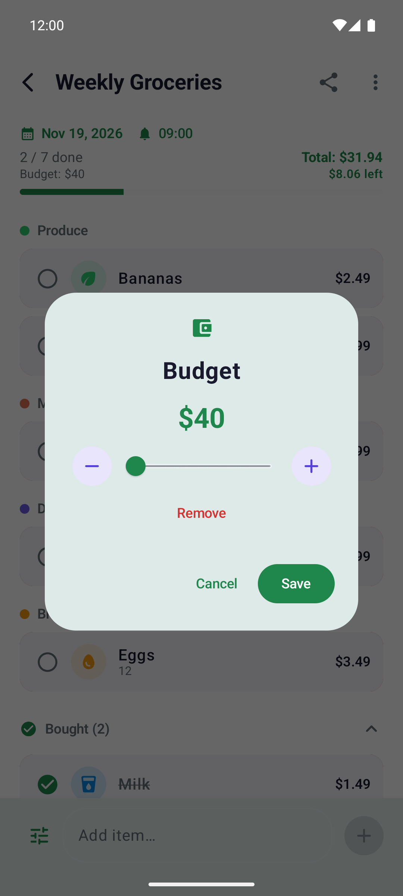
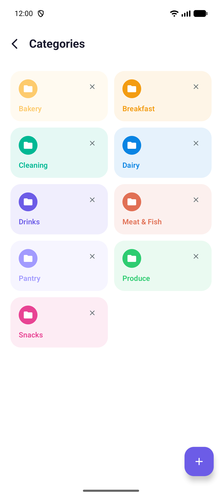
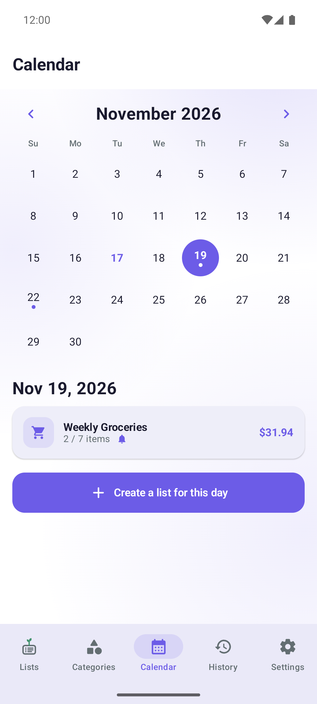
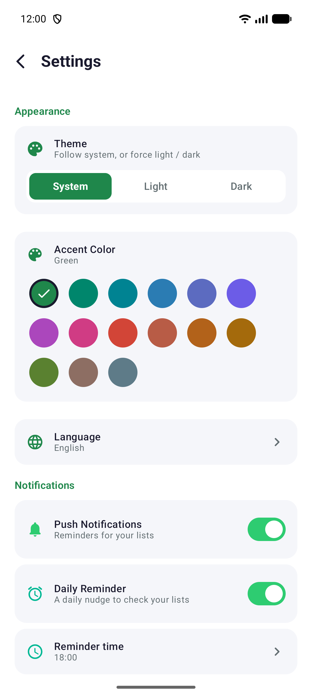

<p align="center">
  
</p>

<h1 align="center">Listo</h1>
<p align="center"><em>Your shopping, sorted.</em></p>

<p align="center">
  A fast, offline-first Android shopping list that files every item under the right
  aisle by itself — so the list is already sorted by the time you reach the shop.
</p>

<p align="center">
  
  
  
  
</p>

---

## Screenshots

| Lists | Auto-sorted items | Budget |
|---|---|---|
|  |  |  |

| Categories | Calendar | Accent colours |
|---|---|---|
|  |  |  |

## Try it

Download the latest APK from **[Releases](https://github.com/AigennA/listo-app/releases/latest)**
and open it on an Android phone (Android 7.0 or newer). Because it is not installed from
Google Play, the phone may ask you to allow installs from this source — that is normal
for apps installed directly.

## Privacy

- **Your lists stay on your phone.** No account, no sign-up, no server, no analytics.
- **One banner ad from Google AdMob.** In the EEA, the UK and Switzerland Listo asks for
  consent first, and the choice can be changed any time in Settings.
- **Feedback is opt-in.** *Help & feedback* opens your own email app; if you write to us,
  the email is used only to reply and is deleted within 12 months.

Full text: **[Privacy Policy](https://aigenna.github.io/privacy-policy/listo.html)**.

## What it does

- **Sorts itself.** Type an item and Listo files it under the matching aisle —
  produce, dairy, bakery, meat & fish, drinks, pantry, cleaning, breakfast, snacks.
- **Tracks progress.** Tick items as you shop; ticked ones move to a Bought section at
  the bottom and a progress bar shows how much is left.
- **Watches the budget.** Give items a price and the list a budget; Listo shows what's
  left or how far over you are, in your phone's currency.
- **Reuses lists.** Rename, share, copy or delete a list from My Lists — tap ⋮ or swipe
  it left. A copy comes back with every item unticked, ready for next week.
- **Plans ahead.** Schedule a list for a date with an optional reminder, and see the
  whole month in the built-in calendar.
- **Keeps history.** Finished lists move to History rather than disappearing.
- **Shares.** Send any list as plain text.
- **Adapts.** Light / dark / system theme, twelve accent colours, and three languages
  (English, Türkçe, Svenska).
- **Stays readable.** Each accent colour is tuned to meet WCAG AA text contrast in both
  light and dark mode, and the colour picker works with TalkBack.

Everything runs **offline**. There is no account, no sign-up and no server — your
lists are stored only on your device.

How it is built — architecture, testing, localisation, accessibility and release
preparation, with links into the code — is described in [SKILLS.md](SKILLS.md).

## Tech

| Area | Choice |
|---|---|
| UI | Jetpack Compose, Material 3, Compose Navigation |
| Architecture | MVVM with use cases; repository over Room |
| DI | Hilt |
| Persistence | Room (lists, items, categories), DataStore (settings) |
| Async | Kotlin Coroutines + Flow |
| Ads | Google AdMob banner (a single banner on the list screen) |
| Min / target SDK | 24 / 36 |

Source layout:

```
app/src/main/java/com/listo/app/
├── data/          Room entities, DAOs, repositories, domain models
├── domain/        Use cases
├── di/            Hilt modules
├── ui/
│   ├── screens/   Splash, onboarding, lists, list detail, calendar,
│   │              categories, category items, history, settings
│   ├── components/ Reusable Compose pieces (top bar, cards, ad banner…)
│   ├── theme/     Colour, typography, shape, accent contrast
│   └── viewmodel/ One view model per screen
└── utils/         Grocery catalog, date helpers, notifications, preferences
```

## Building

Requirements: JDK 17+, Android SDK with API 36, Android Studio Koala or newer.

```bash
git clone https://github.com/AigennA/listo-app.git
cd listo-app
./gradlew assembleDebug        # or: ./gradlew installDebug
```

Run the tests:

```bash
./gradlew test                 # unit tests
./gradlew connectedAndroidTest # instrumented data-layer tests (needs a device)
```

Debug builds use Google's **test** AdMob unit ids, so no real ad impressions are ever
generated while developing.

## Store assets

Everything needed for the Google Play listing lives under [`store/`](store/): the
512×512 icon, the 1024×500 feature graphic and the listing copy in English, Turkish
and Swedish. The privacy policy is published at
[aigenna.github.io/privacy-policy/listo.html](https://aigenna.github.io/privacy-policy/listo.html)
(source: [`docs/privacy-policy.html`](docs/privacy-policy.html)).

Screenshots come in two sets: `store/screenshots/phone-en/` holds the raw emulator
captures (used above), and `store/screenshots/play-phone-en/` holds the 1080×1920
9:16 versions that Play Console accepts — captioned and framed by
`store/graphics/render-play-screenshots.ps1`.

## License

All rights reserved — this code may not be copied, modified or reused without written permission. See [LICENSE](LICENSE).
